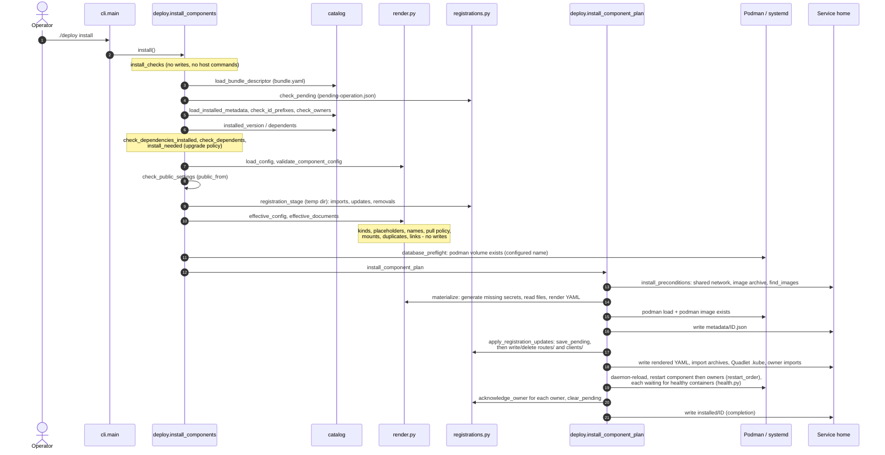
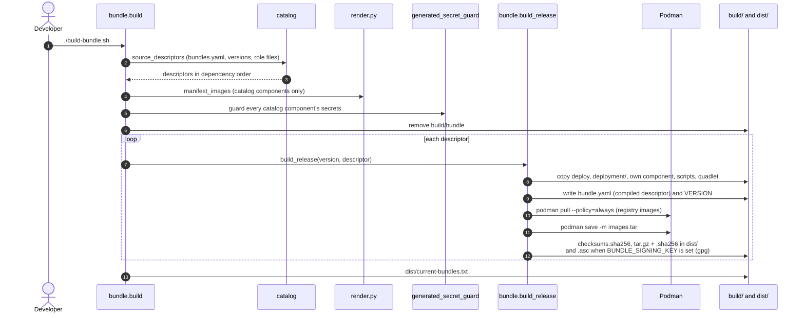

# Deployment architecture

Use the root `./deploy prepare|install|uninstall` and `./deploy init-config
<component>` commands. The wrapper changes to its own directory and executes
`python3 -B -m deployment`, so callers need not enter a release directory and
trusted code creates no `.pyc`/`__pycache__`. `./build-bundle.sh` is the stable
build entrypoint and also uses `-B`.

## Modules

| Module | Responsibility |
| --- | --- |
| `deployment/__main__.py` | Minimal CLI delegation |
| `deployment/cli.py` | Arguments, exit codes and concise errors |
| `deployment/common.py` | Release/service-user paths, name rules, shared constants and DeployError |
| `deployment/catalog.py` | Read and validate the component model: catalog, compiled bundle descriptor and installed metadata; dependency order, role owners, the product name (`product_name`, `unit_name`) and per-component paths (`component_paths`) |
| `deployment/render.py` | Config/YAML loading and validation, generated-secret helpers, file groups, manifests, images and import archives |
| `deployment/templates.py` | Shared single-pass substitution for ConfigMap data and Secret recipes, scoped input policies and private composition from loaded file Secrets; no writes or host commands |
| `deployment/health.py` | Waits after each restart until the unit's app containers run and are healthy (podman inspect state only) |
| `deployment/registrations.py` | Public route and client registrations (staging, comparison, writing) and the pending-operation record (retry state); used by install and uninstall, imports neither |
| `deployment/deploy.py` | Initialization, DB/host checks, dependency/version checks, Quadlet/systemd and component lifecycle |

`common.ROOT` is the directory above the package, both in source and unpacked
bundles. `common.HOME` follows the service account's user-database home. There
are no lifecycle actions during package import. Modules share these explicit
paths without circular imports or a dependency framework.

Rendering is split so validation visibly precedes side effects (0.4.10). On
install and dev `prepare`, `registrations.registration_stage()` runs first: it reads
and validates routes and client registrations into a temporary directory and
writes nothing else. Then:

1. `render.effective_config()` validates a component's config and adds the
   derived `PUBLIC_HOSTNAME`.
2. `render.effective_documents()` returns the manifests as they will be
   installed, with whole-value placeholders replaced and public ConfigMap `data`
   composed by the shared substitution callback, and checks everything decidable from
   declarations: resource kinds, names after substitution, pull policy, mounts,
   duplicates and the links to config and imported registration volumes. It
   writes nothing.
3. `deploy.database_preflight()` reads those documents, so Podman is asked
   about the configured volume. It is the first host command.
4. `render.materialize()` then creates allowed missing secrets, reads the file
   groups, composes `SECRET_TEMPLATES` using those loaded file bytes (checks that
   need file bytes run here), and returns the YAML and
   import volumes.

`deploy.check_manifests()` runs `deploy.validate_component()` (step 2 plus the
PostgreSQL layout, from declarations only) and then the database preflight;
install, dev `prepare` and both standalone paths use it before any generation.
`./deploy validate` (`deployment/validation.py`) runs `validate_component()`,
the same staging and, in a bundle, `install_checks()` and
`install_preconditions()` (shared network, image archive, image names), but no
volume query: it writes nothing and runs no host command. It reports the first
finding per component. Its only earlier-than-lifecycle checks are declared file
sources by existence and type and the database password declaration; each is
commented with where install or prepare does the same. A new declaration check
belongs in `validate_component()`, `install_checks()` or
`install_preconditions()`, never inline in `install_component_plan()`. Install also checks the image
archive and that every image is fully qualified before step 4. General secret
generation never performs database volume checks.

Only `Pod`, `ConfigMap`, `PersistentVolumeClaim` and `Secret` documents are
supported. `render.pod_specs()` is the one traversal of pod specs and refuses
every other kind first, so a `Deployment` cannot pass some lifecycle checks and
skip others ([components](docs/COMPONENTS.md#manifest-resource-kinds)).

## Declared component model (0.4.9)

The component model is data. `bundles.yaml` (the catalog) declares each
component's dependencies, version file, upgrade policy, `public_from` contract
and route/client roles; [docs/COMPONENTS.md](docs/COMPONENTS.md) is the schema
reference. `catalog.py` is the single reader and validator:

1. `load_catalog()` checks IDs, fields, dependencies, cycles and role owners.
   `source_descriptors()` also checks directories, role files and confined
   version files, and compiles one descriptor per component in dependency order.
2. `bundle.py` writes that descriptor as the bundle's `bundle.yaml`;
   `load_bundle_descriptor()` reads it on the target.
3. `deploy.write_installed_metadata()` records it as `metadata/<id>.json`;
   `load_installed_metadata()`, `installed_components()` and `dependents()` read
   it back strictly. A completion marker without metadata is an error.

Decisions read only these descriptors: `install_needed()` (upgrade policy),
`check_dependencies_installed()` / `check_dependents()` (version ranges),
`check_public_settings()` / `check_kept_shares()` (`public_from`, `shares`), `role_owners()` (who accepts routes
and clients), `registration_stage()` (which registrations exist and which owner
imports them) and `restart_order()` (reverse dependency order). No module names
a demo component. The demo's certificate and user provisioning is the explicit
`dev/demo-credentials.sh` / `dev/generate-certificates.sh`, which product bundles do not contain.

## Lifecycle

`install_components()` validates before any write: the bundle descriptor, the
installed metadata plus this descriptor as one set of known components
(conflicting owners refused), pending conflicts, dependency and dependent
ranges and the declared `public_from` settings. It then stages and validates
registrations in a temporary directory (`registration_stage`), and only then
checks the effective manifests and DB state (`check_manifests`), whose
database preflight is the first host command. A `newer-only` component with an equal installed version is excluded
from rendering; its images are still verified and its registrations still
staged.

The incoming release is authoritative for its own registrations: staging never
copies the selected component's installed route or client, and a role the
release no longer declares becomes a removal. Absence for any other component
never means removal.

`install_component_plan()` then reads as explicit steps:

1. Check the existing shared network, the image archive and that every image
   is fully qualified, then materialize the validated manifests once
   (`render.materialize`: generate missing secrets, render YAML).
2. Load this bundle's archive and verify every required image.
3. Write the installed metadata, so registrations name a known component.
4. Record unfinished registration owners, including owners of removed
   registrations, then write or delete public registrations.
5. Write the rendered YAML, its import archives, Quadlets and changed owner
   imports.
6. Reload systemd, restart the component and then changed owners
   (`restart_order`), check `is-active` and acknowledge each owner.
7. Write the installed version marker last as completion.

The sequence describes the established behavior, including secret materialization
before image loading and possible persistent file changes before a service
failure. It is not rollback or permission to move safety checks earlier/later.
Image failures leave deployed registrations/services untouched. Route changes
restart the route owner and client changes the client owner; unchanged
registrations with no pending work restart no owner. Sibling apps remain
running.

Because owners are saved before a removed registration disappears, a retry in
a new process still rebuilds their imports and restarts them.
`restart_service()` and `acknowledge_owner()` are shared by install and
uninstall.

Uninstall records its validated own volume inventory, deletion choice, stop
checkpoint and unfinished owners (`uninstall_plan()`) before destructive work. It can resume after
YAML, markers or data are gone. The private `pending-operation.json` persists
across process runs; conflicts are refused rather than guessed away. See
[retry safety](acceptance/RETRY-SAFETY.md). Run one lifecycle command at a time.

Source dev preparation uses the same defaults, registration indexes and renderer
against `build/dev/<component>`. `prepare_standalone()` and
`install_standalone()` isolate the supported root-config examples/test fixtures
from the component path; they are not migration or old-release adapters.

## Sequence diagrams

The Mermaid source below is authoritative. For viewers without Mermaid, the
rendered images are in `docs/diagrams/`; run `dev/render-diagrams.sh` after
changing a diagram ([install](docs/diagrams/deploy-install.png),
[build](docs/diagrams/build-bundle.png)).

### `./deploy install` from an unpacked bundle

Validation happens before any write or host command; the database preflight
is the first host command; `pending-operation.json` is saved before
registrations change; the version marker is written last.

### `./build-bundle.sh` in the source checkout

This is the catalog path. Component names as arguments
(`./build-bundle.sh app1`) build only those releases after the same catalog
validation and do not rewrite `dist/current-bundles.txt`. Without
`bundles.yaml`, `bundle.build()` builds one
standalone release instead: `manifest_images()` from `manifests/`, the same
secret guard, then a single `build_release(VERSION)` and no
`dist/current-bundles.txt`.

## Persistent state and trust

Component config and `credentials/`, imported archives, registration directories,
installed metadata and markers, retry metadata and Podman data belong to the service
home. Shared CA/network ownership is unchanged. Release code, defaults, manifests
and images are disposable; production never merges new defaults over existing
config or credentials.

Each offline bundle ships the complete `deployment/` package with checksums and
only its own resources/images. Bytecode and private state, including aliases to
declared secrets/credential files, stay out of archives.

Operators recursively add only `<release>/deployment/` to the existing per-bundle
fapolicyd trust file. The CLI expands directory trust to individual file records.
The read-only wait helper requires every current package file, rejects incomplete
or malformed/duplicate records, and checks that all old package entries disappear
after retirement. Other release files and credentials are not trusted. The
wrapper executes via Bash and Python imports run with `-B`; no new allow/crun/memfd
or SELinux rules are introduced. Directory add/delete semantics follow the
[upstream fapolicyd guidance](https://github.com/linux-application-whitelisting/fapolicyd#managing-the-file-trust-source).

No migration code, fallback root deploy.py or compatibility layer for existing
installations is added. Historical pinned-release helpers and reports retain
their original layouts. Fresh target verification of directory trust is still
required; see [refactor verification](acceptance/DEPLOY-REFACTOR.md).

## Private app file delivery (0.4.4)

App `credentials/todo/` files, including the session key and private OIDC client
key, use `SECRET_FILES` (`app1-signing` / `app2-signing`). The backend alone mounts
the Secret read-only at `/certificates`, with explicit keys and file mode `0400`
for the current container-root process. These files no longer use `VOLUME_FILES`
or a signing-PVC import archive. Shared route/client imports keep their existing
public archive normalization. Source files, credential generation, persistent
config precedence and lifecycle retry state are unchanged.

Identity no longer generates or delivers the unused API-secret environment
value. Its API scopes, signing credentials, users and database are unchanged.
There are no new images, automatic migration, credential cleanup or rotation.
Real Podman permissions/isolation remain unverified; see
[credential delivery verification](acceptance/CREDENTIAL-DELIVERY.md).

## Explicit signing PFX provisioning (backlog 44)

`dev/generate-certificates.sh --root DIR --component ID --purpose signing --pfx`
is an explicit operator action, separate from deploy's generation/validation.
It embeds the isolated signing implementation in the shell helper so stdin
execution on offline targets needs no source checkout or additional module.
Legacy demo recipes remain unchanged and the shipped Identity still reads PEM.

The private `credentials/signing/pfx-password` is provisioned first. After path,
mode and password checks, a per-root lock serializes explicit signing calls.
`provision()` chooses retained/external PFX, then PEM, then existing/new local CA
issuance. `verify_pfx()` checks private-key accessibility, the leaf certificate
and any supplied PEM; `publish()` uses an atomic hard link without overwrite.
Private scratch files are removed on ordinary success/failure. Export failure
retains PEM/password for retry; interrupted pair publication fails closed until
the operator restores the partial pair. No deploy state or completion marker is
changed by provisioning. The source credentials stay outside disposable releases.

An individual-file SECRET_FILES source delivers only the PFX through the existing
binary Secret pipeline and 0600 install YAML; the mount/path is the application's
contract. No source/password/CA delivery or application-specific branch is added
to deployment/. The current helper can be invoked explicitly in dev/production,
using separate roots, or consume external credentials; its local issuance still
uses development CA defaults. Supported CA configuration, tool delivery and
renewal are separate items 45a/45b/45c. See [PFX credentials](docs/PFX-CREDENTIALS.md)
for commands, precedence, failure recovery and pending real runtime checks.

## Supported layout checks (0.4.5)

Lifecycle commands, dev preparation and the certificate script no longer inspect
historical core/combined-platform paths, services, markers or volumes. There is
no old-layout detector, migration, fallback or automatic cleanup. The supported
component graph and ordinary version/dependency contracts are unchanged. Current
DB preflight still refuses a missing password for an existing database volume;
private path checks, pending-operation validation and scoped deletion remain.
Certificate preparation no longer requires Podman just to check obsolete volumes.

The active acceptance runner no longer offers historical migration/refusal
scenarios. Pinned 0.2.0 fixtures and verification reports remain unchanged;
[cleanup verification](acceptance/LEGACY-CHECK-CLEANUP.md) lists the retained
historical references and current checks.

## File sources and generation (0.4.6)

`SECRET_FILES` and `VOLUME_FILES` each map resource IDs to lists of sources:
`{path: credentials/database, generate: [password]}` creates the missing local
password and delivers files from that directory. `{path: ../clients}` only reads
prepared files. Multiple file/directory sources are supported by one model.
`file_group_sources()` validates the structure; `generated_secret_paths()` resolves
and validates generation without creating or reading files. Generation still
occurs at the same lifecycle boundary after database preflight. The obsolete
separate top-level field and string-only source entries are rejected.

Bundle protection follows every declared Secret source and generated file,
including generation under VOLUME_FILES and symlink aliases outside credentials/.
No config migration/fallback or eager credential creation is introduced.
Persistent config precedence, mounts/names, images and the current component
architecture remain unchanged. See
[file-source verification](acceptance/FILE-SOURCES.md) for results and limits.

## Derived Secret values (0.4.12 Identity)

`SECRET_TEMPLATES` maps component-prefixed Secret IDs to key/text recipes.
`templates.validate()` checks syntax and config inputs against file-key names;
`render.check_templates()` is shared by config/manifest validation, including
standalone fixtures. `templates.documents()` consumes the already loaded file
Secret documents inside `materialize()`, after generation and database preflight.
It returns Opaque Secrets without separate persistent files or logs. Names, links,
key validation and uninstall inventory include these Secrets. File sources used
only by templates count as consumed; template-to-template references are refused.

The password file remains authoritative and byte-preserved. Derived values are
recomputed only when rendering actually runs: an equal `newer-only` release and
an ordinary systemd restart keep the installed YAML. Changing a file does not
rotate a PostgreSQL role's password. Backup/restore pairs DB data with credentials
and config; derived values can be recreated. Rendered YAML and Podman storage
contain recoverable values, and env delivery exposes them to runtime inspection.

Identity 0.2.2 receives `ConnectionStrings__Default` through `secretKeyRef` and
no longer has an in-image builder or database-password mount. Its PostgreSQL
pod still uses the original password file. Python apps retain file consumption.
No new fapolicyd/SELinux rules or host/runtime dependencies are introduced.
See [Secret templates](docs/COMPONENTS.md#secret-templates) and backlog 41 for
input restrictions and the pending real lab verification. The operator explicitly
deferred the prerequisite probe to the lab run after local implementation.

## Public ConfigMap composition (0.4.12 platform)

`templates.substitute()` uses a standard-library regex replacement callback for
both private recipes and ConfigMap `data` strings. `config_text()` resolves only
ordinary string/integer config and explicitly refuses Secret references. Secret
validation/materialization supply their own resolver and retain their input
character rules. There are no expression, recursion or dollar-template semantics.

`render.configmap_data()` inspects original values to distinguish inline text
from whole-value placeholders. This prevents a value inserted by `replace()`
from being interpreted as another recipe, preserves whole-value type/conversion
behavior, and keeps `replace()` unchanged. `validate_component_config()` uses the
same helper before init-config writes; `effective_documents()` uses it before
lifecycle generation. The existing unresolved-marker check still rejects inline
placeholders in every other field.

The platform settings ConfigMap now carries public `PUBLIC_ENDPOINT`; its proxy
receives it with the existing `envFrom`. Lab `healthy()` follows that reference
and checks the rendered value against its public inputs and the running
container's `printenv`, including the renamed gateway. No image, private file,
trust policy or runtime dependency changes are needed. Real lab verification
remains pending under backlog 41.

## Standard nginx proxy (0.4.7)

Platform now references the stock `docker.io/library/nginx:1.28-alpine` image.
Its public ConfigMap template and the short shell startup command live entirely
in platform manifests; apps/proxy/ is removed. The startup command uses the
container's DNS and a two-variable envsubst whitelist before exec nginx. TLS,
public route imports, dynamic upstreams and health/port settings are preserved.
No deployment renderer, app build/pull helper or bundle builder code changed.
The existing image discovery/pull/archive path handles nginx as a registry image.
Explicit data deletion also removes mounted ConfigMap volumes declared by the
selected component; environment-only ConfigMaps add no volume to that list.
The validated names are saved in the existing uninstall pending record before
any destructive steps, so retry still works after the rendered YAML is removed.
Ordinary uninstall retains these volumes along with the component's other data.
See [proxy verification](acceptance/NGINX-YAML.md) for scope, source review and
checks; real nginx/Podman/SELinux behavior still requires the lab.

## App1 schema initialization (0.4.8)

App1 retains separate database and Todo pods. Sorted manifest order places the
database first in dev and production. The Todo pod's `prepare-database` init
container uses the shared backend image and database password Secret to create
the Todo table idempotently. Podman init type `always` reruns preparation on pod
start; failure prevents ordinary Todo containers from starting. Connection/SQL
timeouts, an availability deadline and a hard process alarm bound the init step.

The app1 backend checks the table under `TODO_SCHEMA_MODE=external`; app2 retains
backend-driven creation using the same DDL. The shared image becomes 0.2.2 and
app/help release VERSION becomes 0.4.8. Platform/Identity versions stay 0.4.7.
No host lifecycle/render/build code, credentials, volumes or dependency rules
change. The existing database-runtime lab action also exercises real init and
replay with a retained row in its disposable database. See
[init verification](acceptance/APP1-INIT.md) for local tests and runtime gaps.
