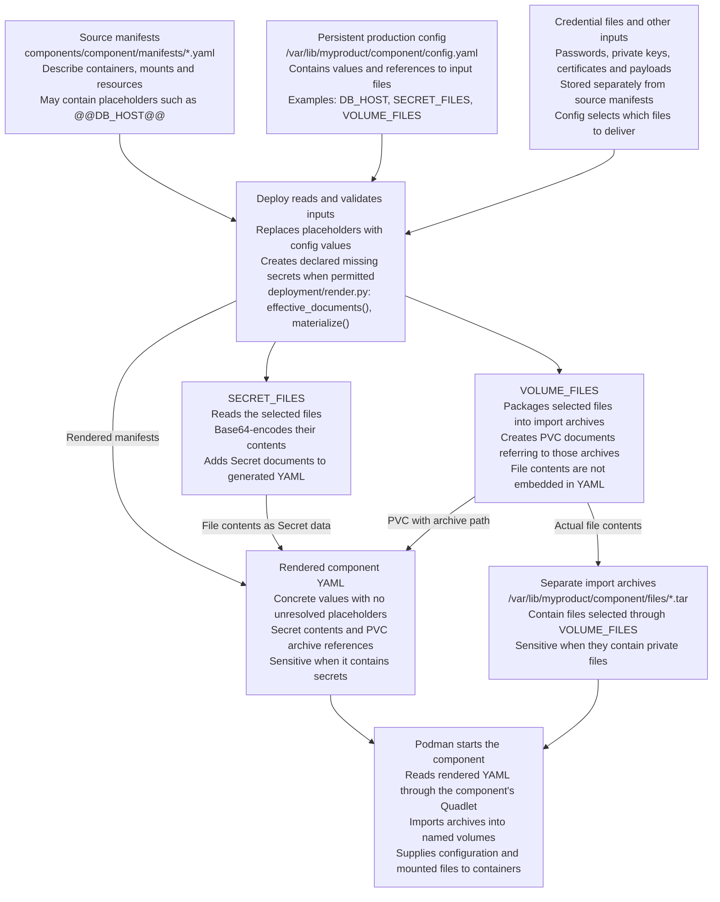
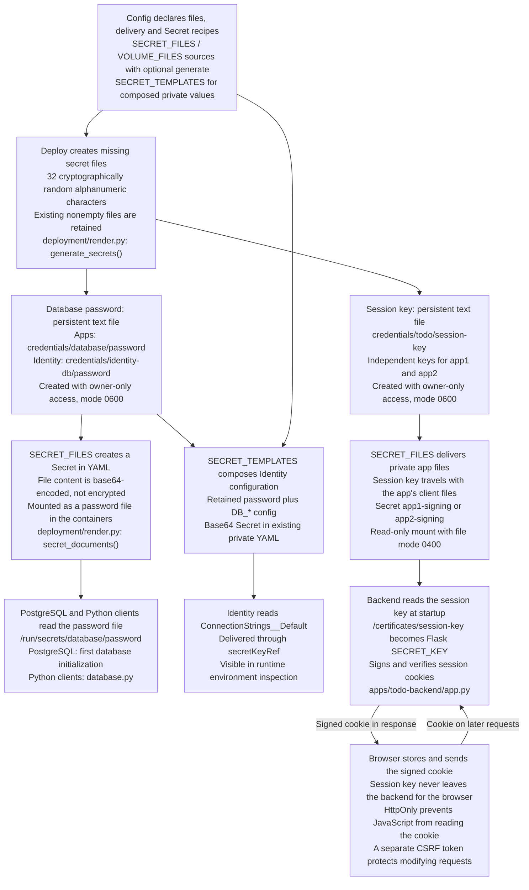
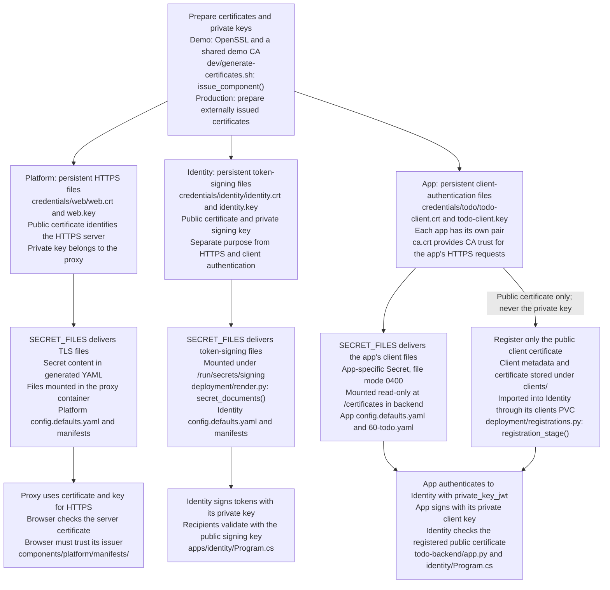

# Rootless offline Podman demo

Build on a machine with network, transfer checksummed bundles, then install as
one service user on an offline host. Python 3.6+ and PyYAML 5.4.1/6.x are the only
product Python requirements. Podman 5.x, Quadlet, systemd, OpenSSL and Bash are
required on the target. The demo uses Duende IdentityServer, PostgreSQL, two Todo
instances, nginx and a static help app.

Planned work is tracked in [BACKLOG.md](BACKLOG.md).

The deploy package and lifecycle flow are described in [ARCHITECTURE.md](ARCHITECTURE.md).
The root `./deploy` command runs `python3 -B -m deployment` from its own directory,
including when called from outside the release. It creates no Python bytecode.

## Components and bundles

Components are declared, not built into the tools: `bundles.yaml` lists the
product's components, their dependencies, version sources and roles, and
`components/<id>/` holds each one's manifests, defaults and registrations.
Adding, renaming or removing a component changes only those files. See
[components and the catalog](docs/COMPONENTS.md) for the schema, the installed
metadata and complete add/remove examples. The shipped demo product is:

| Bundle | Components | Dependencies | Public paths |
| --- | --- | --- | --- |
| `myproduct-platform-<v>-offline.tar.gz` | platform | none | HTTPS proxy and routing |
| `myproduct-identity-<v>-offline.tar.gz` | identity | platform | `/identity/` |
| `myproduct-app1-<v>-offline.tar.gz` | app1 | platform + identity | `/app1/` |
| `myproduct-app2-<v>-offline.tar.gz` | app2 | platform + identity | `/app2/` |
| `myproduct-help-<v>-offline.tar.gz` | help | platform | `/help/` |

### Product name

`product:` in `bundles.yaml` names the whole installation. The demo uses
`myproduct`; to install the same product as, for example, `hubbabubba`, change
only that line and rebuild the bundles. Every name the installation gives the
host then follows it:

| What | Name |
| --- | --- |
| Bundle archives and release folders | `hubbabubba-<component>-<version>-offline.tar.gz` |
| Service user and home (`prepare-host.sh` default) | `hubbabubba`, `/var/lib/hubbabubba` |
| Component units and Quadlet files | `hubbabubba-<component>.service`, `.kube`, `.yaml` |
| Shared Podman network | `hubbabubba` (`hubbabubba.network`) |

`./deploy` reads the name from the bundle, so the target needs no other
setting. Lowercase letters, digits and inner hyphens, a letter first, at most
32 characters (it is also a Linux user name). `prepare-host.sh --user <name>`
chooses another service user; then use that name wherever this README uses
the service user. One service user runs one product: install refuses a bundle
of another product before any write. There is no rename of an existing
installation; install the renamed product on a fresh service user.
Image names are not derived from it: each component's manifests name their
images, and the demo's are neutral (`localhost/demo-*`), as is the demo CA
(`Demo Development CA`). `PUBLIC_ORIGIN` (demo default
`https://myproduct-proxy:8443`) is configuration you set to your own DNS name.
Below, `myproduct` is the demo's product name.

Installations made before product names (0.4.10 and older) have no product in
their installed metadata. This release refuses them with a message naming the
file; there is no migration. Remove such an installation with its own releases,
or install on a new service user.

Platform owns the HTTPS proxy, web TLS and public route imports. Identity owns
IdentityServer, its PostgreSQL database, signing keys, API secret, demo users,
Data Protection and public client registrations. Each Todo owns its PostgreSQL
pod, frontend/backend pod, private client key and session material. Both apps
share Identity users but have separate clients, database volumes and cookies.
With all components installed there are 8 pods and 10 app containers. The root
path `/` returns 404; use `/app1/`, `/app2/` or `/help/`.

In `bundles.yaml`, platform accepts routes and Identity accepts OIDC clients;
the apps and help register with them. Each component has its own
`components/<id>/VERSION` containing `major.minor.patch`. Platform and Identity
use `upgrade: newer-only`. All Pod, Secret, PVC and ConfigMap
names must start with their component prefix; the renderer rejects other names
before writes.

Each component has its own `<product>-<component>` Quadlet service. The identical
`<product>.network` is shared and never removed by component uninstall. Install
platform, then Identity, then either app. Help needs only platform; the proxy
starts without Identity DNS. Bundles contain only their own resources and images.
Only a component's own bundle upgrades it. Equal shared versions retain installed
files, newer versions upgrade and downgrades refuse. New required settings are
checked when that component is rendered. Apps retry their databases for 60 seconds.

| Registration change | Owner restarted (demo) |
| --- | --- |
| Public route only | route owner (platform) |
| OIDC metadata/public certificate only | client owner (identity) |
| Both | both owners, client owner first |
| Neither | neither |

The selected app itself restarts on install, before the owners. Public indexes control active
registrations even when old files remain in imported volumes. An app's private
client key never goes to Identity. Issuer, public paths, client IDs, scopes and
cookies retain their existing values.

The supported layout has separate platform and Identity bundles. No existing
installation needs migration from the former core or combined platform layouts.
Deploy and certificate preparation do not scan for those historical paths,
markers or volume names. They neither migrate nor clean up unrelated state.
Normal upgrades in the current model retain config, credentials and data;
current dependency/version checks, database preflight and retry validation remain
in force. See [layout cleanup verification](acceptance/LEGACY-CHECK-CLEANUP.md).

Every `bundle.yaml` is the compiled descriptor of its component and declares
exact dependencies with inclusive `min` and exclusive `before` ranges, for
example `{platform: {min: 0.4.11, before: 0.5.0}, identity: {min: 0.4.11, before:
0.5.0}}` for app1/app2. For 0.x, compatibility follows the minor series; for
1.x and later, the declared major series. The installed descriptor is retained
privately under `metadata/`, independently of old release directories. Incoming dependencies and every installed dependent's range must
allow a shared upgrade. Missing, malformed or incompatible metadata refuses
before mutation. See [Identity verification](acceptance/IDENTITY-SPLIT.md) for
coverage, local evidence and pending lab commands.

## Configuration and initialization

Some setting names have built-in meaning (`PUBLIC_ORIGIN`, `HTTPS_PORT`,
`PUBLIC_HOSTNAME`, `SECRET_FILES`, `VOLUME_FILES`); every other name only
replaces its placeholder in each component separately. A component can share
its own settings with its `public_from` dependents through `shares:` in
`bundles.yaml`. See [reserved configuration names and shared
settings](docs/COMPONENTS.md#reserved-configuration-names).

| File | Role |
| --- | --- |
| `config/common.defaults.yaml` | Shared defaults for initialization and dev |
| `config/dev.yaml.example` | Small example of local dev overrides |
| `config/dev.yaml` | Developer overrides, ignored by Git and excluded from bundles |
| `components/<component>/config.defaults.yaml` | Component-specific defaults, including secret and volume references |
| `/var/lib/myproduct/<component>/config.yaml` | Authoritative persistent production config |

Initialization and dev use exactly one merge rule: common defaults first,
component defaults next, explicit overrides last. Merge is at the top level.
A later value replaces the entire earlier value, including `SECRET_FILES`,
`VOLUME_FILES` maps (including their source lists and generate declarations); no recursive merge or list
concatenation takes place. Duplicate YAML keys are rejected in each source file.
Individual layers may be incomplete; the complete merged result is validated.
Dev overrides apply to all rendered components, with no per-component override
syntax. A missing dev file means no overrides; an invalid existing file fails.
`IP_ADDRESS` belongs to platform because only its proxy binds the host address.

From a verified, unpacked bundle, run as the service user:

```sh
as_product bash "$release/deploy" init-config platform
# Or, from the release directory as myproduct: ./deploy init-config platform
```

Only components included in that bundle may be initialized. The command writes
one complete persistent config, mode 0600 in a private 0700 component directory,
without generating secrets, copying certificates, loading images or starting
services. Symlink paths are rejected. An existing file is retained exactly,
even if empty or invalid; installation still validates it.

On a fresh host, initialize platform from its own bundle, edit its settings, prepare
its credentials and install it. For app1/app2, next initialize and install Identity
from its own bundle before either app. For a platform/help-only setup, install
help after platform; Identity and the apps are not required. Prepare each
component’s certificates/credentials with the certificate script, edit
component-specific settings, then install. A component declaring
`public_from: platform` (Identity, the apps and help) initializes with only the
installed platform config's actual `PUBLIC_ORIGIN` and `HTTPS_PORT` as final
overrides; dev prepare inherits them the same way. Other platform settings are never copied.
An invalid platform config or missing shared setting fails instead of falling back
to release defaults. If platform is installed but its config file is missing, restore
that authoritative file from a private backup before initializing a new component. A help bundle cannot install platform or run without installed
platform. Installation rejects inconsistent shared values; it never rewrites config
to resolve a mismatch.

Production install and upgrade read only persistent component config. Release
defaults are never merged into it, and config is never overwritten or extended
automatically. Existing complete files continue to work unchanged. If a new
release needs an absent key, install fails before image operations with the
persistent file path and key name, without its value. Before retrying, back up
that file privately and explicitly add the required key using `sudoedit`; consult
the release’s defaults and notes for its type and meaning. Add shared changes
consistently to platform and dependents. Defaults are examples for this manual step,
not an automatic migration mechanism. Explicit edits take effect when that
component is rendered during installation. An equal-platform app/help install keeps
installed platform YAML/Quadlet; use a controlled newer-platform release to apply changes
that require rendering platform again. Public route/client imports are updated
independently and restart their respective owners without upgrading their versions.

Relative paths in all three file settings resolve from the materialized config
folder: `/var/lib/myproduct/<component>/` in production and
`build/dev/<component>/` in dev, never from the defaults file. Existing absolute
and `~` paths remain supported for secret/volume inputs. Generated secrets must
stay confined to that component’s config folder, including through symlinks.
Initialization writes path references only; credentials must be prepared separately.

Manifests are rendered before Podman sees them. Whole-value placeholders such as
`Clients__0__AllowedCorsOrigins__0: '@@ALLOWED_CORS_ORIGIN@@'` require a complete
config value, for example `ALLOWED_CORS_ORIGIN: "https://example.test"`.
They preserve YAML types; ConfigMap data is converted to text. ConfigMap `data`
values also accept inline `@@NAME@@` placeholders, including in multi-line files.
Other manifest fields still require whole values. Dollar-style nginx/shell
variables are preserved. Missing inputs identify their key without exposing values;
Secret references are allowed only in `SECRET_TEMPLATES`. See
[ConfigMap inline values](docs/COMPONENTS.md#configmap-inline-values).

The examples in `examples/` and the registry acceptance test still use one
explicit `config.yaml` (and `~/config.yaml` when installed). The product itself
does not; it uses the component config model described above. Older acceptance
reports under `~/podman-offline-acceptance-runs/` may still mention the old
configuration names; those reports are kept unchanged.

## Run locally

```sh
./dev/build-images.sh
./dev/pull-images.sh
cp config/dev.yaml.example config/dev.yaml   # optional local overrides
chmod 600 config/dev.yaml
./dev/demo-credentials.sh                    # demo only: CA, certificates, users
./deploy validate                            # every component, no writes or Podman
./dev/dev.sh up
python3 -m venv .venv-app
.venv-app/bin/pip install -r apps/todo-backend/requirements.txt
APP_BASE_PATH=/app1 .venv-app/bin/python dev/smoke-test.py
APP_BASE_PATH=/app2 .venv-app/bin/python dev/smoke-test.py
./dev/dev.sh down
```

For an external image that requires a signing PFX, use the explicit component
mode documented in [PFX provisioning](docs/PFX-CREDENTIALS.md). It preserves
external/retained credentials and uses the same relative paths in dev and
production; it does not require an `apps/` directory or demo user generation.

`dev/demo-credentials.sh` creates missing demo credentials under `build/dev/`
and reuses them on later runs; it is demo provisioning, not part of the generic
dev lifecycle. `./deploy validate` checks every catalog component with its dev
config (manifests, placeholders, links, images, PostgreSQL layout, declared file
sources by existence and type, route and client registrations) and reports the
first finding of each component; a placeholder or YAML file that cannot be read
while dev config is assembled stops the run, as it stops `prepare`. It writes
nothing, generates no secret, reads no credential contents and runs no Podman
or systemd command; `prepare` and `install` start with the same checks. In an
unpacked bundle it runs as the service user and needs no runtime directory. `dev/dev.sh up` runs `./deploy prepare` for the catalog's
components in dependency order, followed by `podman kube play`. Run
`dev/dev.sh down` before removing a component from the catalog: it stops what
the last prepare rendered.
Run `./deploy prepare` from the source checkout; product bundles reject dev
prepare and use persistent config through install. Standalone fixtures retain
their explicit prepare flow; in a release without `components/`, `./deploy
install` validates `manifests/` against `~/config.yaml`, loads
`images/images.tar` and runs one `myproduct.service` (see the
`install_standalone` docstring for the order). Component prepare merges common defaults, component
defaults and optional `config/dev.yaml`.
The local overrides apply to every rendered component. Generated config under
`build/dev/<component>/` is output, never an input layer; credentials and data
are retained between renders. Keys and import archives also live there. `build/install.yaml` is private
(0600). Down preserves data volumes. Do not delete dev credentials while keeping
the corresponding database volumes: their initialized passwords would differ.
The default HTTPS name is `myproduct-proxy:8443`; the smoke test maps it locally
without editing `/etc/hosts`. A manual browser needs suitable DNS/hosts and CA
trust. Each app uses `/app1/` or `/app2/`; help is public at `/help/`.

Smoke tests use actual HTTPS, OIDC code/PKCE/private_key_jwt, user isolation,
CRUD, CSRF and help navigation. They withhold auth URLs and response bodies on
failure. Set `PUBLIC_ORIGIN`, `CONNECT_IP`, `SMOKE_CA_FILE` and
`SMOKE_PASSWORD_DIR` when checking another installation. JavaScript behavior
still needs a browser check; this is an HTTP integration test.

## Images and offline bundles

Manifests are the only image list. The build reads containers/initContainers
structurally, deduplicates and sorts full names. Every container must use
`imagePullPolicy: Never`; image placeholders and short names are rejected.

- `localhost/<name>:<tag>` is prepared locally before bundling. The demo build
  helper discovers `localhost/demo-<app>:<tag>` from manifests and builds
  `apps/<app>/Containerfile`; the PostgreSQL alias is pulled/tagged explicitly.
- All other full names, including `localhost:<port>/...`, are registry sources.
  Bundling pulls each with `--policy=always` before save. A failed pull stops;
  no cached-image or build fallback is used.

A registry can be any OCI-compatible container registry. Build and publish
those images in your external pipeline, then put their full immutable tags in
component manifests, for example `registry.example.test/team/todo:1.2.3`.
Log in with `podman login <registry>` beforehand; no credentials are handled in
code. For an internal CA use `/etc/containers/certs.d/<registry>/ca.crt` (or the
user-specific certs.d directory). Never disable TLS verification. Prefer tags
that are never reused; digest pinning is deferred until save/load/name behavior
has been verified. Demo localhost tags may be rebuilt while developing an
unreleased version; published release tags must remain immutable.

```sh
./build-bundle.sh
(cd dist && sha256sum -c ./*.sha256)
```

One invocation creates one bundle per catalog component and lists them in
`dist/current-bundles.txt`; older archives in `dist/` are retained, for example
for uninstalling a removed component. `./build-bundle.sh app1 help` builds only
the named components, after validating the whole catalog, and leaves
`dist/current-bundles.txt` unchanged. Only catalog components are scanned for
images. Each bundle contains `config/common.defaults.yaml` (when present), its
component's `config.defaults.yaml`, only its component,
`deploy`/`deployment/`, scripts, Quadlet templates, the compiled `bundle.yaml`,
an informational `VERSION` and its own
`images/images.tar` (standard docker-archive, `podman save -m`) and `images.txt`.
Checksums cover all shipped files. Apps/dev/tests/examples/acceptance and local
config, passwords and keys are not shipped. Optional component `files/` is for
public product payloads. Declarations in common/component defaults and local/materialized dev config prevent generated
secrets from being copied into bundles, including through symlink aliases. Keep
private files out of shipped directories and retain their declarations.

### Signed bundles

`.sha256` files detect a damaged archive, but whoever can replace an archive can
replace its checksum too. With `BUNDLE_SIGNING_KEY` set to an OpenPGP key ID or
fingerprint in the build machine's GnuPG keyring, `./build-bundle.sh` also
writes a detached signature `<archive>.asc` for every archive (gpg must be able
to use the key without a prompt, for example through gpg-agent). Without it the
build prints `[WARN] ... is unsigned` and writes no `.asc`; a rebuilt archive
never keeps an older signature.

```sh
export BUNDLE_SIGNING_KEY=<fingerprint>
./build-bundle.sh
gpg --export "$BUNDLE_SIGNING_KEY" > bundle-signing.gpg   # once; give it to operators
```

Deliver `bundle-signing.gpg` to the target separately from the bundles (for
example on a different medium) and keep it there. The target checks each
archive with `gpgv`, which trusts only that keyring, before the checksum and
before unpacking anything; see the installation steps below. Do not verify with
a script taken from the unverified archive. An archive without `.asc` is
unsigned: install it only if your organisation allows unsigned builds.

## Proxy from YAML

Platform uses `docker.io/library/nginx:1.28-alpine` directly, the same nginx
series/base tag previously used for the custom proxy image. There is no
`apps/proxy/` build recipe. The other application images still use the existing
`dev/build-images.sh`; `dev/pull-images.sh` fetches standard nginx, and the bundle
builder includes it in the platform offline archive. Production loads the
archive and uses `imagePullPolicy: Never`.

`components/platform/manifests/20-proxy-config.yaml` holds the public nginx
template in ConfigMap `platform-proxy-config`. The pod mounts it read-only at
`/etc/nginx/proxy-template`. Its startup command in `80-proxy.yaml` reads the
first nameserver from the container's `/etc/resolv.conf`, substitutes only
`HTTPS_PORT` and `DNS_SERVER` with envsubst, writes the runtime config to
`/etc/nginx/conf.d/default.conf` and executes `nginx -g 'daemon off;'` as the
main process. No host script or custom nginx image is needed.

The existing TLS Secret and route PVC remain read-only at `/run/secrets/web`
and `/routes`. The template includes `/routes/installed.conf`; app/Identity
routes stay separate public registrations. Variable upstreams and runtime DNS
allow platform/help without Identity or apps, and later app additions without
hardcoded backend addresses. The renderer still replaces only whole `@@...@@`
values; nginx variable substitution is explicitly limited at container startup.
See [proxy verification](acceptance/NGINX-YAML.md) for local checks and pending
real-container/lab verification.

## Config, secrets and persistence

Component `credentials/` directories contain passwords, session keys, private
keys and certificates, whether generated locally or supplied externally.
`SECRET_FILES` and `VOLUME_FILES` describe how files reach containers; optional
`generate` on each source selects files deploy creates. Dev uses
`build/dev/<component>/credentials/`; production uses
`/var/lib/myproduct/<component>/credentials/`. Shared `PKI/private` stays in place.
Release 0.4.1 uses this layout for fresh state only, with no path migration,
aliases or fallback. Container mounts, Secret/PVC names and image tags are unchanged.
See [credential-path verification](acceptance/CREDENTIAL-PATHS.md) for results
and remaining historical references.

`PUBLIC_ORIGIN` must be an HTTPS origin with no credentials, path, query or fragment.
Invalid values are rejected with the config path and field name; their contents
are never included in the error.

Prod reads `~/platform/config.yaml`, `~/identity/config.yaml`, `~/app1/config.yaml`, `~/app2/config.yaml` and
`~/help/config.yaml`. Relative `SECRET_FILES`/`VOLUME_FILES` paths are resolved
from that config's directory; absolute paths and `~` are supported. Config keys
are strings, ordinary values are text/integers and `HTTPS_PORT` is an integer.
Duplicate YAML keys, inline placeholders outside the allowed fields, unresolved
references, missing mounts
and colliding Secret/PVC/ConfigMap names are rejected. Whole `@@NAME@@` values
preserve int/string types; ConfigMap data becomes text.

`SECRET_FILES` maps resource IDs to lists of source mappings, each with a `path`
and optional `generate`. It encodes file contents into Secrets (about 375 kB per id).
Directories expand one level; nested directories are not allowed for Secrets.
A Secret's keys are its file names (and `generate` names); every key a pod
selects (`secret.items[].key`, `secretKeyRef.key`) must be one of them, or
`validate`, `prepare` and `install` refuse before generating anything, naming
the keys that exist. Only names are read, never contents.
`SECRET_TEMPLATES` maps Secret IDs to key/text recipes and composes complete
private values from `@@NAME@@` config inputs and
`@@secret:<secret-files-id>/<file-key>@@` file inputs. Operators may supply a
declared `SECRET_FILES` source after `init-config`; it must exist before install,
and `validate`/`install` report a missing file. Results are recomputed
when the component renders, with no separate persistent derived file, and are
encoded in the same 0600 YAML. Use `secretKeyRef` for unchanged apps reading a
complete environment value or a Secret mount for file-aware apps. Environment
values remain visible to the service user and root in Podman inspection and
process environments. See the [schema, example and input restrictions](docs/COMPONENTS.md#secret-templates).
Only Secret templates and ConfigMap `data` accept embedded placeholders; other
manifest fields keep whole-value replacement. ConfigMaps accept only ordinary
string/integer config inputs and refuse `@@secret:...@@`. `validate` never reads Secret contents. Equal `newer-only` installs
and systemd restarts do not recompute templates.

`VOLUME_FILES` creates private import tar archives and PVCs. Import archives
normalize ownership, modes and timestamps (mtime 0), so identical imported
content has a stable checksum across fresh staging directories. Podman imports at
start, overwriting matching files while preserving app-created/unlisted files.
Symlinks in product output/state paths are refused to prevent sibling writes.

Both delivery groups use the same declaration format:

```yaml
SECRET_FILES:
  app2-database-password:
  - path: credentials/database
    generate:
    - password
  app2-signing:
  - path: credentials/todo
    generate:
    - session-key
```

`path` can identify a file or a directory. Multiple sources may be listed under
one resource ID. Without `generate`, the source must already exist: certificates
and private keys are still prepared separately by the certificate script or
provided externally. With `generate`, `path` identifies a directory and each
listed filename is relative to that directory. The example creates
`credentials/database/password` and `credentials/todo/session-key` if missing,
then delivers the files from those directories through their respective Secrets.
Other existing files in a declared directory are delivered as before.

The same source list works in `VOLUME_FILES`, including optional `generate`:

```yaml
VOLUME_FILES:
  identity-clients:
  - path: ../clients
```

Generated files must stay under the config directory: absolute, tilde,
traversing and symlink-escaping generation paths are rejected. Provided sources
without generation still support relative/absolute paths and `~`. Missing
selected files are created exclusively with 32 random alphanumeric characters,
mode `0600` and private parents. Existing nonempty files are retained; empty
files and duplicate generation declarations are errors. No values are logged.
Add new source/generate declarations explicitly to authoritative persistent
config during ordinary future upgrades; never replace old database passwords.
Back these files up with the database and other persistent state. See the
[generated-secret example](examples/generated-secrets/README.md).

`GENERATED_SECRETS` and string-only source lists are no longer valid config.
There is no migration, fallback or automatic rewrite of persistent config.

```text
/var/lib/myproduct/                         service-user home, 0700
├── platform/, identity/, app1/, app2/, help/
│   ├── config.yaml                        0600, retained across releases
│   ├── credentials/                       0700, passwords/keys/certificates retained
│   └── files/                             0700; import archives 0600
├── PKI/private/                           0700; shared demo CA
├── routes/<component>.conf                public route registrations
├── clients/<component>/                   public OIDC metadata/certificate
├── metadata/<component>.json              installed descriptor (dependencies, roles), 0600
├── installed/<component>                  installed version, written last, 0600
├── .config/containers/systemd/             scoped .kube/.yaml + shared .network
├── .local/share/containers/storage/        images, DB data and secret volumes
└── releases/myproduct-<bundle>-<version>/   code/manifests/images, disposable
```

Proxy and identity consume imported volumes, not host bind mounts. The renderer
collects public registrations into current route/client indexes. Only those
indexes are used at runtime: Podman imports do not delete removed files, so stale
files left in volumes must not keep an uninstalled route/client active.

The certificate script creates the shared demo CA and platform web TLS pair once.
Identity owns its signing pair and demo-user passwords. Deploy generates database passwords separately. Each app gets
its own client private key/certificate and database password. Database passwords,
session keys use source-level `generate`. Identity receives only public client
certificates. Its signing key and each Todo's private signing/session material
are delivered through their own backend-only Secrets.
`PKI/private/ca.key` on the target is for the demo only. In real prod, issue
certificates elsewhere and deliver them to the persistent component paths.
See [PKI](PKI/README.md). PostgreSQL's entrypoint creates a superuser in each
separate cluster; each app creates/owns its tables, with no migration/GRANT role.
Duende needs an appropriate [production license](https://docs.duendesoftware.com/identityserver/overview/licensing/).
Local Todo logout clears only that app's session; shared identity SSO remains.

### From source YAML to container configuration

Source manifests are templates, not the complete configuration Podman runs.
Deploy combines them with the component's persistent production config and input
files on the host. Whole-value placeholders such as `@@DB_HOST@@` become concrete
config values. `SECRET_FILES` embeds file content in generated Secret documents;
`VOLUME_FILES` delivers file content in separate import archives referenced by
generated PVC documents.



`component` in the diagram stands for the selected component, such as `app1`.
In development, `./deploy prepare` uses materialized config and credentials under
`build/dev/` and writes the combined `build/install.yaml` for `podman kube play`.
Production install uses persistent config and writes component-specific YAML for
Quadlet. The diagram shows data flow; validation and image checks still gate the
installation steps described in [ARCHITECTURE.md](ARCHITECTURE.md).

Base64 is encoding, not encryption: generated YAML containing Secret data must
be protected along with credential files and private import archives. A PVC's
YAML contains the archive reference, not the files inside it. Missing-secret
generation is controlled by source-level `generate` and lifecycle preflight;
certificates must already have been prepared separately. The following diagrams
show how specific credentials pass through these two delivery mechanisms.

### Password and session-key flow

Read these diagrams from creation, through persistent host files and container
delivery, to application use. Paths starting with `credentials/` are relative to
the component's persistent directory: `/var/lib/myproduct/<component>/` in prod
or `build/dev/<component>/` in dev. Code paths are relative to the repository root.
Production uses the existing component `config.yaml`; release defaults are used
when initializing that file, not merged again during installation.

Original credentials have persistent source files, including passwords and
session keys. Derived connection strings are recreated from those sources and
config. A secret value is confidential information; a Kubernetes `Secret`
is one delivery mechanism. App session keys and private client keys are delivered
through app-specific Secrets; public registration directories still use PVC imports.



`deployment/deploy.py: database_preflight()` runs after manifest validation and
before generation, on the effective manifest (placeholders replaced). A missing
database password with an existing database volume stops installation; deploy
does not invent a replacement password for retained database state. A container
that sets any `POSTGRES_PASSWORD*` variable or mounts `/var/lib/postgresql/data`
counts as a database container and must use `POSTGRES_PASSWORD_FILE` with a
mounted Secret; any other password layout is refused before generation.

The session key is an application-wide signing key, not a per-user password or
the key used to authenticate the app to Identity. Flask stores signed session
data in the browser cookie; signing does not encrypt that data. The backend reads
the key into memory at startup. Keeping the same key across restarts and upgrades
allows existing cookies to remain verifiable. Changing it requires a deliberate
session-invalidation or rotation policy.

App session keys and private client keys are delivered through `SECRET_FILES` as
`app1-signing` / `app2-signing`, mounted read-only only in the backend at
`/certificates`. The Secret volume specifies `defaultMode: 256` (octal `0400`)
and explicit file keys. The current backend image runs as container root; the
owner-only files are intended for UID/GID 0 inside that rootless container. A
future non-root image requires a matching ownership/delivery design and tests.
No app signing-PVC or private credential import archive is generated. General
public import archives retain their existing normalized modes.

Persistent source files remain private and are not rotated at restart, upgrade
or retry. Rendered YAML contains base64-encoded credentials and is written with
mode `0600`; base64 is not encryption. A Secret does not promise encrypted or
memory-only Podman storage. Actual file ownership, modes and mount isolation
remain subject to [target verification](acceptance/CREDENTIAL-DELIVERY.md).

### Certificate and private-key flow

Certificate preparation is a separate operator step before `deploy install`.
The demo uses `dev/generate-certificates.sh --root /var/lib/myproduct
<component> <DNS-hostname>`; see the complete commands below. It is demo
provisioning and is not part of the product bundles (which ship only
`scripts/prepare-host.sh`); copy it from the source checkout to the target and
run it on stdin. The script creates
a shared demo CA under `PKI/private/` and missing component certificate/key pairs.
Run credential provisioning explicitly before `dev/dev.sh up`; the generic dev
launcher does not issue certificates. Production can deliver external files or
invoke the explicit signing helper with its own persistent root/CA. Supported
production PKI configuration and tool delivery remain backlog 45a/45b. Deploy
loads the prepared files; it does not issue certificates.

The demo recipes write separate PEM files: `.crt` contains the public certificate
and `.key` contains the private key. Optional named-component PFX export, password
provisioning and external-file precedence are documented in
[PFX credentials](docs/PFX-CREDENTIALS.md); its
[complete provisioning](docs/PFX-CREDENTIALS.md#complete-provisioning-for-a-product-with-its-own-identity-image)
section gives the full order (password file, proxy TLS with CA settings, signing
PFX) for dev and production. Existing nonempty pairs are retained,
incomplete pairs cause an error, and rerunning does not automatically renew
certificates. The following diagram shows the demo PEM flow.



The diagrams omit demo-user password creation. The unused Identity API-secret
generation and environment delivery have been removed. API scopes, client
certificate authentication and Identity token signing are unchanged.

The session-cookie example is specific to the Flask Todo backend. A different
application must explicitly consume its credential files using its own framework;
deploy and Podman do not infer a file's purpose from the name `session-key`.

## First production installation

Run as the operator with sudo. Install the `platform` bundle first.
For an app installation, install `identity` next, then `app1` and/or `app2` in
either order. For a platform/help-only installation, install `help` after
`platform`; help requires neither Identity nor either app. Platform can also
remain installed on its own.

`--port`, every `HTTPS_PORT` and the port in `PUBLIC_ORIGIN` must agree.
The archive is opened by the operator and streamed to the service user, which cannot
read the operator's private home. No `cd` by the operator into the 0700 service
home is needed. Shell scripts run through `bash` under fapolicyd.

```sh
product_name=myproduct  # product: in bundles.yaml; also the service user
bundle=platform
version=0.4.11
archive="$product_name-$bundle-$version-offline.tar.gz"
# Signed bundles: the organisation's public key, delivered separately.
gpgv --keyring ./bundle-signing.gpg "$archive.asc" "$archive"
sha256sum -c "$archive.sha256"
stage=$(mktemp -d "/tmp/$product_name-install.XXXXXXXX")
tar xzf "$archive" -C "$stage"
sudo bash "$stage/$product_name-$bundle-$version/scripts/prepare-host.sh" --port 8443
rm -rf -- "$stage"
```

prepare-host creates the system user named after the product (`myproduct` in
the demo) with home `/var/lib/<user>` and nologin shell, allocates noncolliding subuid/subgid ranges, enables linger
and opens the HTTPS port permanently. SELinux stays Enforcing. Storage outside
the normal home uses Podman's [troubleshooting guide, point 11](https://github.com/containers/podman/blob/v5.8.2/troubleshooting.md#11-podman-run-fails-with-cannot-open-shared-object-file):
`/var/lib/containers` is mapped to `/var/lib/<user>/.local/share/containers`.
Unexpected existing equivalences fail instead of being deleted automatically.
Recursive restorecon excludes storage; only the storage directory itself is
restored nonrecursively. Never run recursive or force restorecon on filled storage.

Use these helpers for subsequent commands:

```sh
# Run commands as the service user from its home and systemd runtime.
as_product() {
    sudo -H -u "$product_name" bash -c '
        cd "$HOME" || exit
        export XDG_RUNTIME_DIR="/run/user/$(id -u)"
        exec "$@"
    ' bash "$@"
}
# Require every installed component container to be running and healthy.
healthy() {
    as_product env PRODUCT_NAME="$product_name" python3 - <<'HEALTH'
import os
import pathlib
import subprocess
import yaml


def main():
    """Check each installed Pod container without printing private inspect fields."""
    paths = sorted((pathlib.Path.home() / ".config/containers/systemd").glob(os.environ["PRODUCT_NAME"] + "-*.yaml"))
    if not paths:
        raise SystemExit("No installed component manifests")
    for path in paths:
        with path.open() as stream:
            for doc in yaml.safe_load_all(stream):
                if doc.get("kind") != "Pod":
                    continue
                for container in doc["spec"]["containers"]:
                    name = doc["metadata"]["name"] + "-" + container["name"]
                    state = subprocess.check_output(
                        ["podman", "inspect", "--format", "{{.State.Status}} {{.State.Health.Status}}", name],
                        universal_newlines=True, timeout=10).strip()
                    print(name + " " + state)
                    if state != "running healthy":
                        raise SystemExit("Wait for healthy before continuing")


main()
HEALTH
}
# Wait for an exact trust entry and, optionally, removal of an old release.
wait_trust() {
    local wanted=${1%/}/ removed=${2:-} expected dump status attempt
    if [[ -n $removed ]]; then removed=${removed%/}/; fi
    expected=$(sudo -n find "$wanted" -type f -print) || {
        echo 'FAIL: could not enumerate package trust files' >&2; return 1;
    }
    [[ -n $expected ]] || { echo 'FAIL: empty deployment package' >&2; return 1; }
    for attempt in {1..30}; do
        dump=$(timeout 10 sudo -n fapolicyd-cli --dump-db) || {
            echo 'FAIL: could not read trust database' >&2; return 1;
        }
        status=0
        awk -v expected="$expected" -v wanted="$wanted" -v removed="$removed" '
            BEGIN {
                count=split(expected, files, "\n")
                for (i=1; i<=count; i++) required[files[i]]=1
            }
            {
                path=$0
                sub(/^[^[:space:]]+[[:space:]]+/, "", path)
                sub(/[[:space:]]+[0-9]+[[:space:]]+[[:xdigit:]]+[[:space:]]*$/, "", path)
                if (NF < 4 || path !~ /^\// || $(NF-1) !~ /^[0-9]+$/ ||
                    length($NF) != 64 || $NF !~ /^[[:xdigit:]]+$/) invalid=1
                if (index(path, wanted) == 1) {
                    if (!(path in required) || ++seen[path] != 1) invalid=1
                }
                if (removed != "" && index(path, removed) == 1) old=1
            }
            END {
                if (NR == 0 || invalid) exit 2
                for (path in required) if (seen[path] != 1) exit 1
                if (old) exit 1
            }
        ' <<< "$dump" || status=$?
        case "$status" in
            0) printf 'PASS: package trust ready for %s; removed=%s\n' "$wanted" "${removed:-none}"; return;;
            1) printf 'WAIT: package trust update pending for %s; removed=%s (%s/30)\n' "$wanted" "${removed:-none}" "$attempt";;
            *) echo 'FAIL: invalid or empty trust database output' >&2; return 1;;
        esac
        if [[ $attempt != 30 ]]; then sleep 1; fi
    done
    echo 'FAIL: trust update did not finish within 30 checks' >&2
    return 1
}
```

Unpack and recursively trust only the verified release's `deployment/` package. Trust uses one file per
bundle; never trust the whole release, private keys, crun rules or memfd rules.
The CLI expands that directory into individual trusted files. Wait for every
package file to appear in the database; on upgrade also wait until all files
beneath the old package path disappear. Do not trust the shell wrapper, config,
credentials or other release directories. Repeat signature, checksum and trust
for each release:

```sh
gpgv --keyring ./bundle-signing.gpg "$archive.asc" "$archive"
sha256sum -c "$archive.sha256"
release="/var/lib/$product_name/releases/$product_name-$bundle-$version"
as_product mkdir -p "/var/lib/$product_name/releases"
as_product tar xzf - -C "/var/lib/$product_name/releases" < "$archive"
sudo bash -c 'cd "$1" && sha256sum -c --quiet checksums.sha256' bash "$release"
sudo fapolicyd-cli --file add "$release/deployment/" --trust-file "$product_name-$bundle"
sudo fapolicyd-cli --update
wait_trust "$release/deployment/"
# Start with bundle=platform, then identity, then app1/app2; help needs only platform.
as_product bash "$release/deploy" init-config "$bundle"
sudoedit "/var/lib/$product_name/$bundle/config.yaml"
# On platform, set PUBLIC_ORIGIN, HTTPS_PORT and IP_ADDRESS first.
# Demo only: dev/generate-certificates.sh copied from the source checkout.
as_product bash -s -- --root "/var/lib/$product_name" "$bundle" myproduct-proxy < generate-certificates.sh
sudoedit "/var/lib/$product_name/$bundle/config.yaml"
# Checks the bundle against config and installed components; changes nothing.
sudo -H -u "$product_name" bash -c 'cd "$1" && exec bash ./deploy validate' bash "$release"
sudo -H -u "$product_name" bash -c 'cd "$1" && exec bash ./deploy install' bash "$release"
sudo systemctl --user -M "$product_name@" status "$product_name-$bundle.service"
```

Set IP_ADDRESS in platform to the target's host IP. Set PUBLIC_ORIGIN/HTTPS_PORT
consistently in each component; use the DNS name passed to the certificate
script. The proxy pod's hostname is derived from PUBLIC_ORIGIN, so app pods
resolve that same HTTPS name internally. Each install validates the user database
home and runtime, renders, loads/verifies images, writes component imports/units
and calls `systemctl --user`. It then waits up to 150 s until every app
container of the restarted units is running and, where it has a health check,
healthy; an unhealthy container or the timeout fails the install with the
container's name and state (rerun install after fixing the cause; owners are
retried). `healthy` below additionally checks every installed component, and
HTTPS/e2e checks the application itself.

For app1/app2, after platform repeat checksum/unpack/trust with `bundle=identity`
and `components/identity/VERSION`; initialize Identity, prepare its credentials and install.
Then repeat with `bundle=app1` or `bundle=app2` and that component's `components/<id>/VERSION`, in either order;
initialize that app's config, prepare its credentials, edit its component-specific
settings and install. Keep existing platform and Identity config.

For help, including a platform/help-only setup, repeat after platform with
`bundle=help` and `components/help/VERSION`; run
`as_product bash "$release/deploy" init-config help` and install. Identity
and the apps can be omitted. Help needs no new credentials. These installs update shared routing/client imports
and restart their changed owners (platform for routes, Identity for clients),
while retaining the other app's service/data.

## Upgrade and uninstall

Identity can be upgraded alone: transfer the newer Identity archive/checksum,
verify/unpack/trust it, retain `~/identity/config.yaml` and all credentials, and
install from that bundle. Verify new running image/content, login, both apps'
retained data and database operations before retiring old Identity trust. An
unchanged Identity route leaves platform running; app services remain running.
Platform/app bundles need no retransmission. Installed apps' Identity requirements
must allow the requested version.

Failed lifecycle commands can be repeated from the same component's verified,
trusted bundle. Retry `./deploy install`, or repeat `./deploy uninstall` with
exactly the original `--delete-data` choice. The private
`~/pending-operation.json` records unfinished registration owners or the scoped
uninstall plan before relevant changes. Required imports are rebuilt and owners
restart until the existing `is-active` check succeeds. Confirmed owners are
removed from pending work individually; uninstall remains resumable after its
YAML or data has been removed. Config and credentials remain untouched unless
the original uninstall explicitly requested data deletion.

An unfinished operation blocks other component installs/uninstalls and config
initialization, with a message naming the component and command to finish first.
A changed deletion flag, invalid record or symlinked state is refused. Do not
delete/edit the pending file to bypass the check. Run one lifecycle command at a
time; the record is retry metadata, not a concurrency lock or rollback mechanism.
It cannot reconstruct unknown partial operations performed by older installers.
See [retry verification](acceptance/RETRY-SAFETY.md) for coverage and limits.

Help can be upgraded alone: transfer only the new help archive/checksum, verify
and trust its deployment package in the help trust file, install, verify healthy services
and new HTTPS help content, then retire the old help release/trust entry. App
bundles need no retransmission. With an unchanged route, platform is not restarted.
A changed help route restarts platform explicitly, without changing platform version or
restarting app services.


For an upgrade, verify/unpack/trust the new bundle as above, using the same own
trust file. Reuse persistent config and credentials: do not copy defaults
or generate a new CA/password set. Install and check health/e2e first. Only after
success remove the old own trust entry, leaving other bundles' trust untouched:

```sh
sudo fapolicyd-cli --file add "$release/deployment/" --trust-file "$product_name-$bundle"
sudo fapolicyd-cli --update
wait_trust "$release/deployment/"
sudo -H -u "$product_name" bash -c 'cd "$1" && exec bash ./deploy install' bash "$release"
as_product podman ps
healthy
sudo fapolicyd-cli --file delete "/var/lib/$product_name/releases/$product_name-$bundle-$old_version/deployment/" --trust-file "$product_name-$bundle"
sudo fapolicyd-cli --update
wait_trust "$release/deployment/" "/var/lib/$product_name/releases/$product_name-$bundle-$old_version/deployment/"
```

Use the `healthy` helper defined above. Also verify HTTPS and application e2e
before removing the previous trust entry.

Then old release directories can be deleted. Keep component configs, credentials,
files, shared PKI and Podman storage. Back up databases and private persistent
state; none of it belongs to a release directory.

Use a currently trusted release of the bundle to uninstall its own component:

```sh
as_product bash "$release/deploy" uninstall
# Destructive option: also delete this component's data/secret volumes and state.
as_product bash "$release/deploy" uninstall --delete-data
```

`uninstall [<component>] [--delete-data]` accepts only the bundle's own
component. The bundle of a component removed from the source catalog still
uninstalls it; keep that earlier bundle until the component is removed.

Choose one of those commands. Default uninstall retains data/config/credentials
for reinstall. It removes only the own service, version marker, route and public
client; only the changed registration owners reload their imports. Network and sibling data/units
are retained. Remove the own deployment package trust entries after uninstall and update
the trust database. Identity cannot be removed while either app remains; help
does not block it. Platform cannot be removed while Identity, apps or help remain.
After removing dependents, uninstall Identity and platform from their own bundles.

Podman Secret contents also remain in named volumes after down/stop; removed
Secret keys can remain there. The private home/storage restricts host access.
Explicit own-data deletion removes those volumes too. Never enable KubeDownForce:
it can delete database volumes. At final host removal, remove all release trust,
`loginctl disable-linger <user>`, remove the storage fcontext equivalence with
`semanage fcontext -d /var/lib/<user>/.local/share/containers`, and optionally
`userdel -r <user>`. These are destructive operator choices, not bundle install steps.

fapolicyd's subject cache must be large enough that processes are not evicted
while they start: an early eviction can make rule `deny_audit perm=any
pattern=ld_so : all` deny systemd's launch of Podman (`203/EXEC`,
`subj_trust=unknown`). Set `subj_cache_size = 16381` in
`/etc/fapolicyd/fapolicyd.conf` and `systemctl restart fapolicyd` before
installing; `prepare-host.sh` warns when it is smaller. This tunes the cache
only and does not change any rule. With 4099 the lab showed six early
evictions per acceptance run (`fapolicyd-cli --check-status`). If a restart
still fails this way, rerunning `./deploy install` completes the pending
owner work.

Rootless is the only production mode. On the OL9.8 lab, rootful crun fails with
fapolicyd rule 5 while loading libraries after its detached-mount clone; see
[Red Hat's symptom](https://access.redhat.com/solutions/7072618).
With allow_filesystem_mark=0, rootless container namespaces are outside fapolicyd's
observation, not approved by it. SELinux remains Enforcing. Host systemd health
launchers still need clean audit evidence; no security rules are weakened.

## Health checks and acceptance

Every ordinary container has one exec liveness probe: initial delay 10 seconds,
period 10, timeout 5, six failures (0.4.10; previously 90/30/5/3). A container
is usually healthy about 10 seconds after a start, still has about 70 seconds
to finish starting before it is restarted, and a hung container is restarted
after about 90 seconds. Status is starting until the first check succeeds after
each restart. PostgreSQL uses pg_isready, identity checks its local /health
via Bash /dev/tcp, backend uses Python against local /livez, frontend/help use
local wget and proxy uses wget against its own HTTPS /livez. No probe depends on
another pod. Backend /api/health checks the database only for e2e/control.

```sh
as_product podman ps
as_product podman inspect --format '{{.State.Health.Status}}' app1-todo-backend
as_product podman healthcheck run app1-todo-backend
as_product /usr/lib/systemd/user-generators/podman-user-generator --dryrun
```

systemctl is-active is not an individual container health check. Linger must
keep the rootless timer/user instance alive. The manual
[VM checklist](examples/VM-CHECKLIST.md) covers policy-based labels and read-only
restorecon classifications. Local [unit tests](tests/README.md) need no Podman;
[examples](examples/README.md) exercise real Podman; the
[acceptance harness](acceptance/README.md) tests clean dev-to-offline-prod snapshots,
registry-only downloads, HTTPS, crash/hang recovery, reboot and upgrades.
Previous monolithic run-23 passed on 2277a71; component acceptance results must
be recorded separately and old evidence is never changed.

## Adding an app

Follow the add/remove examples in [components and the catalog](docs/COMPONENTS.md):
a component directory plus a `bundles.yaml` entry, with no Python or shell
changes. For a new demo-style app also consider:

| Need | Files and changes |
| --- | --- |
| Image | A full registry tag in the manifest, or `apps/<app>/Containerfile` for a local `localhost/demo-<app>` demo image. |
| Config | `components/<id>/config.defaults.yaml` for initialization and dev. Operators explicitly edit existing prod config; never overwrite credentials. |
| Pod/health | Prefixed Pod/Secret/PVC/ConfigMap names, Never pull policy, Always restart and the agreed exec liveness timings. |
| Database | Own PostgreSQL pod/PVC/password; do not reuse another app's cluster/password. |
| Proxy/OIDC | `route.conf` with `routes: platform`; `client.yaml` with `clients: identity` and `public_from: platform`. |
| Credentials | Prepare them yourself, or extend the demo provisioning script deliberately. |
| E2E | Extend dev/smoke-test.py and acceptance/markers.py with new app/isolation/persistence checks. |
| Docs | Update overview, tests/README and acceptance/README. |


## App1 database init container

App1's `app1-postgres` is a separate pod, declared in `40-postgres.yaml` before
`app1-todo` in `60-todo.yaml`. Both dev's combined kube YAML and production's
component YAML retain this order. PostgreSQL starts independently; the Todo
pod's init container never waits for a regular container in its own pod.

`prepare-database` runs `python /app/schema.py` from the same versioned backend
image. It connects to the configured database using the same mounted
`app1-database-password` Secret as PostgreSQL and the backend, then executes
`CREATE TABLE IF NOT EXISTS todos`. It mounts no client signing/session files.
Connection attempts have a two-second timeout, availability retries stop after
60 seconds, SQL/lock waits are limited to five seconds, and the init process has
a hard 75-second limit. Failures exit nonzero with a sanitized diagnostic.

Podman must complete init successfully before starting the Todo backend/frontend.
The pod annotation selects init type `always`, so a pod start reruns the
idempotent preparation. App1's backend uses `TODO_SCHEMA_MODE=external`: it
checks the required table and columns and refuses startup if they are missing;
it does not create them as a substitute for init. Repeating init preserves
existing rows, IDs, database volumes and credential bytes. After fixing a failed
database/credential setup, retry the same dev or bundle install command.

App2 still creates its own Todo table from backend startup. Both apps use
`localhost/demo-todo-backend:0.2.2`; rebuild it on the build machine with
`dev/build-images.sh`. Existing manifest discovery includes it once in each
app's offline archive, covering both app1 init and backend. No packages or images
are fetched on the target. Other images, component dependencies, data ownership
and platform/Identity services are unchanged. See
[init verification](acceptance/APP1-INIT.md) for local evidence and pending lab checks.

## PostgreSQL configuration and credentials

Host, port, user and database name are ordinary component configuration. The
password is generated once by `generate: [password]` on its `SECRET_FILES` source
and retained as persistent secret state. That same declaration delivers it as
a Kubernetes Secret. PostgreSQL uses
that Secret for first initialization, and its client uses the same password.
Applications requiring a complete connection string can use `SECRET_TEMPLATES`
and consume the result through `secretKeyRef`, as Identity demonstrates.

Each database-owning component has `DB_HOST`, `DB_PORT`, `DB_USER` and `DB_NAME`
in its `config.defaults.yaml`. The port must be quoted text containing an integer
from 1 through 65535. A top-level dev `DB_PORT` override applies to all database
components; help can carry that unused value without requiring a database. Server `POSTGRES_USER`, `POSTGRES_DB` and `PGPORT`, and client
`DB_*` environment values use whole-value placeholders; password placeholders are confined to `SECRET_TEMPLATES`. Complete connection
strings appear only as base64 Secret data in the existing private install YAML.

| Owner | DB host | User / database | Persistent password below component directory | Secret / key | PostgreSQL volume | Client |
| --- | --- | --- | --- | --- | --- | --- |
| identity | identity-postgres | identity / identity | credentials/identity-db/password | identity-database-password / password | identity-data | Identity |
| app1 | app1-postgres | todo / todo | credentials/database/password | app1-database-password / password | app1-data | app1 Todo backend |
| app2 | app2-postgres | todo / todo | credentials/database/password | app2-database-password / password | app2-data | app2 Todo backend |

The component directory is `/var/lib/myproduct/<component>` in production and
`build/dev/<component>` in dev. No DB settings belong in common defaults.
The table documents default identities; manifests/config remain the source of
truth. The two Todo users have the same name in **different clusters** and have
independently generated credentials.

Identity's `SECRET_TEMPLATES.identity-database` composes the retained password and
ordinary `DB_*` config into `ConnectionStrings__Default`. The container receives
it through `secretKeyRef` and uses only that complete environment value, matching
unmodified .NET images. `--database-check` connects with the same value and emits
only pass/fail diagnostics (exit 0/2/3; missing/invalid config exits 1).
The former in-image `DatabaseEnvironment.cs` builder is removed in Identity 0.2.2.
Add the declaration explicitly to an existing installation's authoritative config
before upgrading; new defaults never replace persistent config automatically.

The Todo examples keep an alternative application interface: `database.py` reads
the same `DB_*` values and mounted Secret file, and passes separate keyword
parameters to `psycopg`. It does not use .NET connection-string syntax. Dev and
production use the same images, secret keys, parameter validation and startup code.

For the file-based Python clients, password files must contain nonempty UTF-8 text. Like the PostgreSQL image’s
[`file_env`](https://github.com/docker-library/postgres/blob/master/17/bookworm/docker-entrypoint.sh)
shell command substitution, clients remove **only trailing LF bytes**;
spaces, tabs, dollar signs, semicolons, quotes and equals signs are preserved.
Embedded LF, CR (including CRLF) and NUL are rejected because initdb's password-file
interface cannot safely represent multiline credentials consistently. Existing
files are never rewritten to normalize them. `SECRET_TEMPLATES` instead rejects semicolons, quotes, control characters and
leading/trailing whitespace in substituted values; generated passwords satisfy
this rule. Psycopg receives keyword arguments and retains its broader input support. Passwords are not restricted to the
new generator's alphanumeric alphabet.

Before component rendering or secret generation, deploy derives the server's
password Secret and database PVC from its manifest. If the file exists, it must
be valid and is retained byte-for-byte. If it is missing, `podman volume exists`
must explicitly report absence before generation is allowed. An existing volume
is conservatively treated as retained database state, even if empty or there is
no installed marker. Podman failures stop the operation. The error names the file
and volume and tells the operator to restore the password from backup or follow a
separate recovery procedure. No volume is deleted, inspected for reinitialization,
or repaired automatically. Dev preparation now needs access to its rootless Podman
volume store when a DB password is missing; `dev/dev.sh up` performs this preflight
before creating certificate state, and `./deploy prepare` performs it before
config output or any generated secrets. Ordinary YAML rendering has no Podman lookup.

PostgreSQL does not update an existing user's password when its Secret file changes.
Client startup verifies authentication with an actual connection. Npgsql reports
SQLSTATE 28P01 for wrong passwords. Psycopg/libpq can omit SQLSTATE during
handshake failure; its private PostgreSQL FATAL password-authentication reply is
classified without printing it. DNS/network failures do not match that reply. Mismatches fail
with a sanitized authentication error; no `ALTER ROLE`, privilege changes or automatic
recovery occurs. Back up and restore the database volume **and** its password file
together. A lost password cannot be replaced with a fresh random password for an
existing database.

### Historical database-password upgrade

The 0.2.0-to-0.2.1 manual database-config upgrade applies only to the former core
layout. Its original instructions and evidence are retained at
[commit 511099e](https://github.com/gunstein/podman_offline/tree/511099e7e056d0d18c4ade95067c30a54c48bec4).
These are historical instructions, not a migration procedure for the current
layout. The current release contains no migration or old-layout refusal scan;
no existing installations require such an upgrade. Historical reports and
fixtures retain their original names and results.

Credentials in the runtime environment are sensitive: do not dump environment,
full inspect objects or connection strings during diagnosis. Administrators and
people with container runtime access can access that state. Acceptance emits only
bounded pass/fail observations and authentication classification, with private input
kept out of argv and evidence.

Password rotation is a separate future task. For each row above it must coordinate
the database user's password, persistent password file and running clients. Session
keys, demo-user passwords, OIDC keys and certificates have different lifecycles.
This release implements no rotation command, dual credentials or rollback framework.

### Certificate issuance settings

`dev/generate-certificates.sh` accepts `--ca-subject '/CN=Organisation CA'`,
`--ca-days 3650` and `--cert-days 365` before its component arguments. All modes
share CA creation and validate settings before writes. Existing credentials and
CAs are retained; changed settings apply only to new material. Use a separate
`--root` per environment and protect/back up `PKI/private/ca.key` (0600).
See [CA configuration and retention](docs/PFX-CREDENTIALS.md#ca-subject-and-certificate-lifetimes-backlog-45a).

Platform tests without demo source: `python3 -B tests/run.py platform --isolate`.
Use `demo` or `all` for the other groups; see [offline test instructions](tests/README.md).
