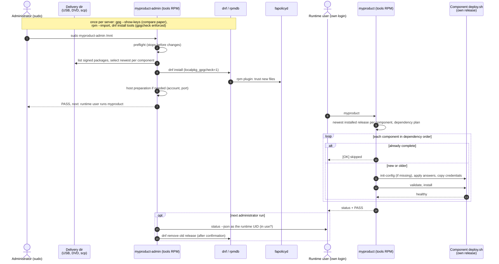

# Item 69 implementation plan: signed RPM delivery, one command per role

Status: plan, 2026-10-25, after the product owner chose the direction in
[item 69](../BACKLOG.md#69-paper-first-installation-for-closed-networks);
not implemented. Read item 69 ("Chosen direction"), the
[RPM prototype results](../acceptance/RPM-PROTOTYPE.md#results-2026-10-25),
the [paper-first lab results](../acceptance/PAPER-FIRST-LAB.md), the
[item 66 plan](INSTALL-SET-PLAN.md), the [review guide](REVIEW_GUIDE.md)
(including section 7) and the current [production manual](PRODUCTION-INSTALL.md)
before implementing.

## Outcome and scope

Today the administrator pastes a 61-line tool bootstrap and a setup block, and
the runtime user pastes a values block and shell blocks of about 3 700
characters per installation. None of it can be typed from a printed manual.

After this item, on a standalone OL9 server on a restricted network:

- **Administrator**, once per server, with OS tools only: compare the key
  fingerprint with the paper, import the key, install `<product>-tools`
  (three short lines). Then, for every delivery: **`sudo <product>-admin`**
  (optionally with the delivery directory).
- **Runtime user**, after logging in directly (console or SSH): **`<product>`**.
- The printed manual is about one page and contains no values block, no
  variables, no pipes and no multi-line blocks.

In scope: supplier build of RPMs, the tools RPM with both commands, prompts
with defaults and the same values as options/answer files, preflight that
stops, retirement with an in-use guard, removal of the `release.py`
publication flow, manual rewrite, harness scenario including a strict
fapolicyd profile. Not in scope: a supplier set manifest (dropped in item 66),
rollback/downgrade, credential generation (45b), encryption at rest (37),
migration of existing lab installations (pre-customer exemption).

## Decisions

| Question | Decision |
| --- | --- |
| Unit of delivery | One signed RPM per release, named `<product>-<component>-<version>` (version in the name, so versions install side by side and `dnf upgrade` never changes a running installation by itself), plus one `<product>-tools` RPM. The release tree is installed unchanged at `/var/lib/<product>/releases/<product>-<component>-<version>/`, as in the prototype. |
| Bundle format | The offline bundle stays the build intermediate and the content of the release RPM (`bundle.yaml`, `checksums.sha256`, `deploy.sh`, images). Its detached `.asc` is no longer part of the customer delivery; the RPM signature replaces it. |
| Trust | Authenticity from the RPM signature, checked by rpm/dnf against a key imported once after a fingerprint comparison on paper. fapolicyd trust from `rpmdb` only; no `fapolicyd-cli --file add`, no protected release records, no stdin bootstrap. |
| Signature enforcement | `<product>-admin` installs only with the check enforced (`dnf --setopt=localpkg_gpgcheck=1`) and refuses an unsigned or foreign-key package before any change. The one-time tools install in the manual carries the same option. `rpm -K` is no longer an operator step. |
| Delivery directory | A plain directory of RPM files and `RPM-GPG-KEY-<product>`, from USB, DVD, a share or `scp`. No repository metadata in the first version: local files with enforced signatures give the same protection with fewer supplier steps. Nothing is executed from the directory, so `noexec` mounts do not matter. An organisation's internal repository can carry the same RPMs (`dnf install` then replaces the directory). |
| Where the orchestration code lives | In `<product>-tools` (`/usr/libexec/<product>/`, Python 3.6-compatible, trusted through rpmdb). `/usr/sbin/<product>-admin` and `/usr/bin/<product>` are small wrappers. Component lifecycle code stays in each release and is always run as that release's own `deploy.sh` child process (item 66 decision), never imported. |
| Tools/release compatibility | Release RPMs carry an explicit `Requires: <product>-tools >= <n>` (written by the build, not generated), so dnf refuses a release that needs newer tools and the delivery includes them. |
| Administrator command | `<product>-admin [DIR]` (default: ask, suggesting `/mnt`): preflight → list signed packages in DIR that are new → print the selection → install with dnf → host preparation (first time, or when a postcondition is missing) → offer retirement of releases no longer in use → print what the runtime user does next. Safe to repeat. |
| Selection guard | From item 66: never install a version older than one installed for that component; with several versions of a component in DIR, take only the newest; ignore other products' packages with a message. |
| Host answers | Account and port are asked the first time and stored in root-owned `/etc/<product>/host.conf` (0644, public values only); later runs reuse them and show them. `--user`/`--port` give the same values non-interactively. |
| Runtime command | `<product>` is item 66's `install-set` with prompts: newest installed release per component, dependency order, skip completed, stop with one instruction when input is needed, resume after interruption. First run asks for public origin, port and IP address with defaults (port from `host.conf`, host name, address of the default route) and for the credential folder; an upgrade asks nothing. |
| Non-interactive use | Every prompt has an option and an answer-file equivalent (item 66's `--settings` data file and `--credentials` directory). Without a terminal, a missing answer stops with exit 3, naming the option. The harness runs the same commands with answer files and, in one test, through a pseudo-terminal. |
| Credential folder | A flat folder of the delivered files (as suppliers deliver them). Each component declares the file names it accepts and their credential group; `<product>` copies only missing files (0600), keeps identical ones, stops on a different one, never prints contents. Replaces the manual's copy loops. |
| Retirement | `<product>-admin` offers to remove old release RPMs once a newer one of the same component is installed **and** in use. "In use" is read as the runtime account (`setpriv` to its numeric UID/GID, no supplementary groups, like `prepare-host.sh`), with `deploy.sh status --json`, never by root parsing its state. The release RPM's `%preun` runs the same check, so a plain `dnf remove` of the installed version is refused with the reason and the right command. |
| Preflight | Stops before any change, naming the item and who acts: OS packages (by package name, "install from the OL9 installation media"), SELinux Enforcing, firewalld, fapolicyd `trust` contains `rpmdb`, `integrity` in `none`/`size`/`sha256`, `subj_cache_size >= 16381`, journald `Storage`/`SplitMode`, account without sudo, free space for the selected packages (installed size, images uncompressed). |
| Supported fapolicyd range | `trust` including `rpmdb`; `integrity` `none`, `size` or `sha256`; with or without rules 1, 2 and 12. Anything else (for example `ima`, `rpmdb` absent) is refused in preflight. To be confirmed by the strict-profile run (work package 0). |
| `release.py` flow | Removed before the first customer installation, with the manual sections 1–3 and retirement: one supported flow and one manual. Its tests and the review-guide contracts move to the RPM flow in the same change. |
| Signing key | One supplier RPM signing key per product, kept outside the source tree; the public key ships in every delivery and its fingerprint on the paper manual. Rotation (a delivery signed with a new key) is an open point. |

## Delivery and update flows

| Situation | Administrator | Runtime user |
| --- | --- | --- |
| New server, first delivery on USB | key check, import, install tools (once), `sudo <product>-admin` | log in, `<product>` (answers prompts once) |
| One DVD per release, at different times | per DVD: `sudo <product>-admin /mnt` | `<product>` after each; a missing dependency stops with its name and nothing changes |
| Update of one app | `sudo <product>-admin` | `<product>`: others skipped, app upgraded; administrator's next run offers retirement |
| Delivery by `scp` | `sudo <product>-admin /var/tmp/<product>-upload` | as above |
| Internal repository | `sudo dnf install <product>-tools <packages>`, then `sudo <product>-admin` | as above |
| Missing OS package | preflight names it; install it from the OS media; repeat | – |

## Sequence (planned)



## Manual target

```text
Administrator, once per new server:
  gpg --show-keys /mnt/RPM-GPG-KEY-myproduct      (compare with this page)
  sudo rpm --import /mnt/RPM-GPG-KEY-myproduct
  sudo dnf install --setopt=localpkg_gpgcheck=1 /mnt/myproduct-tools-*.rpm
Administrator, every delivery:
  sudo myproduct-admin /mnt
Runtime user, after logging in:
  myproduct
```

Plus the fingerprint, the OS package list, how to deliver the credential
folder, and a short table of stops and their remedies. Count commands, typed
characters and account switches in the AI walkthrough (review guide section 7).

## Failure and retry

| Where it stops | Durable state | Next step |
| --- | --- | --- |
| Preflight | nothing changed | the named party fixes it; same command |
| Unsigned/foreign package in DIR | nothing installed | supplier delivers a correct package; same command |
| `dnf install` interrupted | rpm transaction is atomic per package; some packages may be installed | same command installs the rest |
| Host preparation | postcondition checks as item 65 | same command |
| Runtime stop for input | as item 66 (config/credentials kept) | supply the named input; `myproduct` |
| Component install fails | pending record (item 66) | `myproduct` resumes that component first |
| Retirement refused | old release kept | runtime user finishes `myproduct`; administrator repeats |

## Required tests

Product/unit tests with arbitrary names (product `cedar`, components `base`,
`login`, `worker`, account `operator-a`), as in the item 66 plan:

- Build: release and tools RPMs from real bundles; file modes; no generated
  dependencies (only `rpmlib` and the explicit tools requirement); bundles that
  lack `deploy.sh`/required commands are refused (prototype finding 5);
  signature present.
- Admin selection and guard: newest per component, older than installed
  refused, other products ignored, unsigned and foreign-key packages refused
  before dnf runs (command arguments asserted, dnf mocked).
- Preflight: each stop with its message and actor; no host command after a stop.
- Prompts and answers: defaults, options, answer files; no terminal → exit 3
  naming the option; stored `host.conf` reused.
- Credential folder: declared names only, missing copied, identical kept,
  different stops, links/specials refused, contents never printed.
- Retirement guard: in use refused (admin and `%preun`), check runs as the
  runtime UID without groups, unused retired.
- Runtime orchestration: the item 66 tests, run through `<product>`.

Acceptance harness: a new scenario using only the manual's commands, from
`clean-agent` and from a strict-profile snapshot (`trust = rpmdb`,
`integrity = sha256`, rules 1, 2 and 12 removed): first installation from a
delivery directory, real SSH login as the runtime account, `<product>` with a
deliberate stop for a missing credential, an unchanged rerun (no restarts), an
interruption continued in a fresh session, an upgrade with retirement, a
refused `dnf remove` of the installed version, and checks that release files
are trusted from rpmdb only and that there are no FANOTIFY/AVC denials. A
checked mapping from manual steps to harness commands fails on drift.

Existing gates as in `tests/README.md` (platform/demo suites, harness suite,
Ruff, Pyright, Vermin 3.6, shellcheck, link checks, `git diff --check`).

## Work packages

0. **Strict profile first:** add the strict-profile snapshot and a harness
   scenario that installs the prototype RPMs and runs today's runtime flow
   non-interactively. Decides whether the supported range above holds before
   the rest is built.
1. Supplier build: productise `rpm-prototype/` (release and tools RPMs,
   explicit requirement, bundle checks), with tests.
2. `<product>-admin`: preflight, selection, enforced install, host
   preparation (reusing `prepare-host.sh`), `host.conf`, with tests.
3. `<product>`: item 66 `install-set` in the tools RPM, prompts, answer files,
   credential folder, with tests (item 66 packages 1–2 are folded in here).
4. Retirement with the in-use guard and `%preun`, with tests.
5. Manual rewrite (one page) and the AI operator walkthrough with counts.
6. Harness scenario and manual-to-harness mapping; remove the `release.py`
   flow, its tests and manual sections; update review-guide contracts
   ("Production release authentication", "Host preparation", "Operator
   usability") and item 65/66 references.
7. Item 68 human trial on the closed lab: the printed page only, short.

Packages 0–2 are useful alone; 3–5 make the manual short; 6 removes the old
flow only after the new one passes the harness.

## Open points

- Answer-file format shared with item 66's `--settings` (one format for both).
- How the credential folder fits the organisation's PKI or a PFX (45a–45c).
- Checking that the web certificate covers the public host name before install.
- Disk space: store image archives compressed in the release (`podman load`
  reads compressed archives) to avoid the 716 MB installed size seen in the lab.
- Key rotation and a delivery that contains both old and new key.
- Console-only use and one person holding both accounts (login switch only).
- Whether `%preun` failures are clear enough when dnf removes several packages.

## Understandability review to complete

- Success: delivery dir → signature (dnf) → rpmdb → fapolicyd trust → host
  preparation → runtime command → each component's own lifecycle → status.
- Update: new release RPM installed beside the old → runtime command upgrades
  that component only → administrator's next run retires the old one.
- Failure/retry: component 2 install fails → pending record → fresh login →
  `<product>` → resumes component 2 → no restart of component 1.
